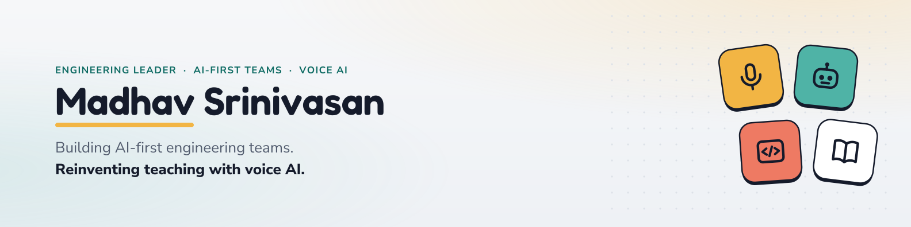

<picture>
  <source media="(prefers-color-scheme: dark)" srcset="./banner-dark.svg" />
  
</picture>

# Hi, I'm Madhav

Engineering leader building AI-first teams. I spent years building software, platforms and engineering organizations. Now apparently my job is to convince machines to build the software while convincing humans that this was the plan all along.

## What I'm working on

I strongly believe voice AI is how teaching changes: every learner gets a teacher they can simply talk to. This is where I try that idea out in public.

- **[State of Voice Agents](https://sbmadhav.com/state-of-voice-agents/)**: a monthly, no-hype look at whether voice AI is ready to answer the phone.
- **[learnvedicmath.com](https://learnvedicmath.com)**: a free learning site, one of my experiments in teaching with AI.
- **[sbmadhav.com](https://sbmadhav.com)**: my corner of the internet, built on its own [design system](https://github.com/sbmadhav/design-system).

## Find me

[LinkedIn](https://www.linkedin.com/in/sbmadhav/) · [sbmadhav.com](https://sbmadhav.com)

The opinions I share here are my own and do not represent my employer, present or past. The machines, for the record, have not been consulted either.
